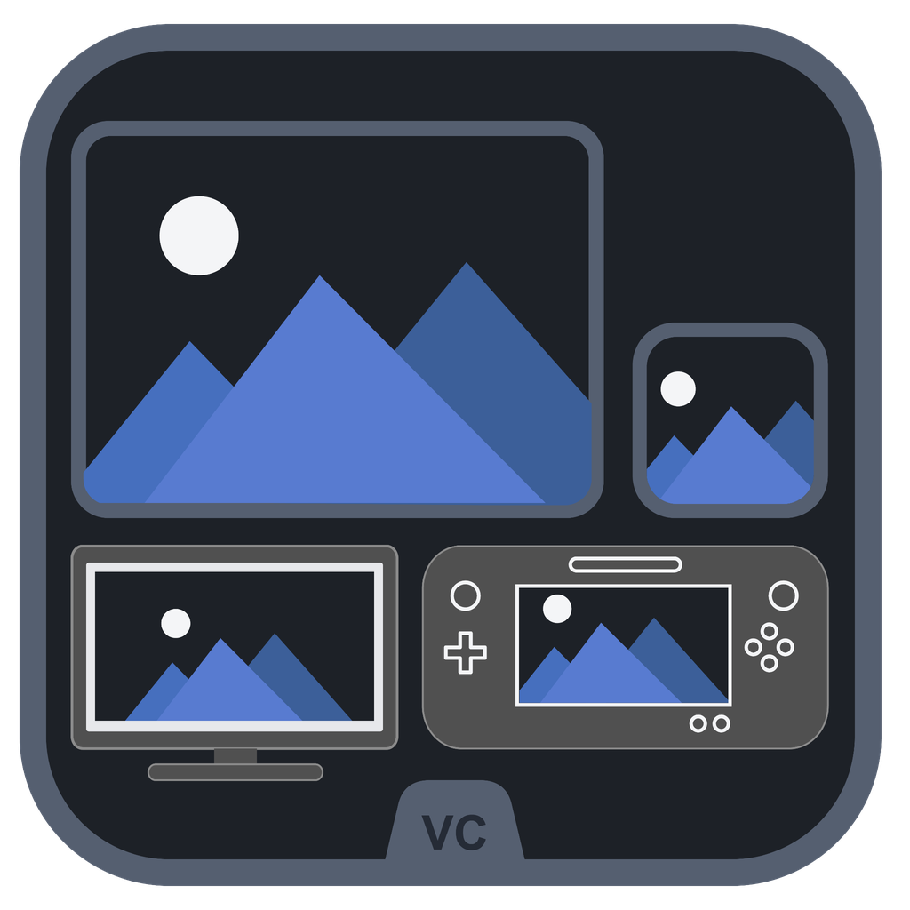

<h1 align="center">Wii U VC Image Studio</h1>

Prepare Wii U Virtual Console artwork and optional boot sounds from your own games.

<a href="#download">Download</a> | <a href="#getting-started">Get started</a> | <a href="#features">Features</a> | <a href="#updates-and-settings">Updates</a> | <a href="#development">Development</a>

## Features

For users preparing artwork for Wii U Virtual Console projects, Studio brings
ROM metadata, screenshots, artwork review and boot sounds into one local window.

- Add ROMs or folders, including drag and drop, and fetch game metadata.
- Search optional community artwork, review alternatives and choose different
  sources for Icon and TV/Gamepad outputs.
- Capture screenshots with configured emulators or import your own images.
- Adjust crop, zoom, source area and metadata overlays with live previews.
- Enlarge individual images or detach the complete preview and Activity panels.
- Import WAV, MP3 or BTSND boot sounds, convert to WAV and preview playback.
- Retain the viewport-fitted v5.05 workspace, original icon and two original chimes.

No ROMs, emulator cores, downloaded community artwork or MyInstants audio are bundled.
This independent utility is not affiliated with Nintendo.

## Download

Get the Windows x64 Portable ZIP from the
[latest stable release](https://github.com/TechSavage1989/Wii-U-VC-Image-Studio/releases/latest).
The [releases index](https://github.com/TechSavage1989/Wii-U-VC-Image-Studio/releases)
also lists previous releases and clearly labeled prereleases. Only published
release assets are approved downloads; an Actions artifact is not a release.

The Windows x64 Portable ZIP contains one folder and the stable
Wii_U_VC_Image_Studio.exe filename. The Source ZIP is for development, not a
prebuilt application. Builds are not publisher-signed; SHA-256 verifies the
download against the release manifest, not publisher identity.

## Requirements

- Windows x64 with Microsoft Edge WebView2 Runtime for the portable build.
  Windows 10/11 are the intended targets; check release notes for tested systems.
- A writable extraction folder and per-user settings storage. Normal use does
  not require administrator rights.
- Internet access only for metadata, repository content and update checks.
- RetroArch and suitable cores for automatic capture; Dolphin may be used for
  GameCube/Wii/WiiWare. Emulators are optional for imported screenshots.
- Python 3.12 x64 is used for development and packaging, not required by recipients.

## Getting started

1. Open the latest stable release and choose the Windows x64 Portable ZIP.
2. Extract its entire folder to a writable location. Do not run inside the ZIP.
3. Launch Wii_U_VC_Image_Studio.exe. Keep that name for a stable shortcut target.
4. Choose an Export folder. Configure emulators only if you want automatic capture.
5. Select Add ROMs or Add Folder, then select a game. Use Import Screenshot or
   Search Artwork to create the first preview and output images.

Image Builder v5.05 has no updater. Close it, extract Studio separately and launch
the new filename once. Repoint any old shortcut explicitly; do not delete the
old application until Studio works. Existing settings are read from the same location.

## How to use

- Game: edit details, choose icon frames and source areas, or open Adjust Crop &
  Zoom. Review Artwork Matches can assign an image to all outputs, Icon only,
  or TV/Gamepad only. Low-confidence matches require review.
- Capture: configure capture timing, output choices and metadata overlays.
  Capture ROM Screens processes checked ROMs. Stop and Use Captures keeps
  available frames for review.
- Boot Sound: choose a built-in sound, Browse for Game or Set Console Sound,
  then Play Boot Sound. Imports are converted to persistent private WAV copies.
- Remove Checked and per-row removal affect list entries, not source ROM files.
- Click previews to enlarge. Detach Preview and Activity Detach open separate windows.

The selected export folder receives per-game folders containing title_screen.png,
Icon Image.png, TV Image.png, Gamepad Image.png, metadata.txt and optional
bootSound.wav. Disabling an output removes that stale generated output during
rebuild. Review source rights before redistributing downloaded images or sounds.

## Updates and settings

Studio checks the stable release feed at startup, every five minutes while online,
and on focus return after at least two minutes. Checks run in the background and
use conditional requests, cached results, cooldowns and failure backoff.
The Updates button starts a manual check. Failed/offline checks report a failure,
not "up to date". Cached successful results do not erase a visible offline error.

An available update shows installed/latest versions and short notes. Download is
explicit. Install and restart is a separate action, blocked during active work.
The current ROM list closes on restart; exported files and saved settings remain.
The installer verifies package size, SHA-256, application/version identity, ZIP
contents and Windows x64 executable resources, then waits for a visible healthy
window. It preserves the running executable filename, including custom names.

- Existing settings: %APPDATA%/Wii_U_VC_Image_Builder/settings.json.
- Custom configuration pointer: config_location.json in that same directory.
- Update cache, staging, diagnostics and rollback: %LOCALAPPDATA%/Wii_U_VC_Image_Studio/updates.
- One previous executable is retained per installation path. Only app-owned
  successful staging is cleaned after the helper exits; failed staging is retained
  for diagnosis. No user ROMs, exports or settings are cleaned by the updater.

See [upgrade and recovery guidance](docs/updates.md) and [release history](docs/releases/README.md).

## Troubleshooting

- If the native window cannot render, verify that WebView2 Runtime is installed.
- If an update check fails, check connectivity and retry after the displayed delay.
  GitHub outages or throttling do not mean the installed version is current.
- If installation cannot write to the app folder, move the extracted app to a
  writable location. Do not disable antivirus or run it elevated as a workaround.
- On failed startup after replacement, the helper attempts to restore the prior
  executable. Review last-result.json and helper-error.json in update storage.
- Downloaded finished Wii U artwork is already rendered. Source-image crop
  controls apply to source screenshots, not those completed output assets.

## Development

Read [AGENTS.md](AGENTS.md) and [DEVELOPMENT_HANDOFF.md](DEVELOPMENT_HANDOFF.md)
first. The Python package and its WebUI remain in vc_extractor/. Build and
validation tools are in scripts/, tests in tests/ and original resources in assets/.

~~~powershell
py -3.12 -m venv .venv
.\.venv\Scripts\python.exe -m pip install -r requirements.txt -r requirements-dev.txt
.\.venv\Scripts\python.exe app.py
.\.venv\Scripts\python.exe -m pytest -q
.\.venv\Scripts\python.exe scripts/check_root.py
.\.venv\Scripts\python.exe scripts/build_windows.py
~~~

Build_Windows_EXE.bat is the convenience wrapper. Release assets appear in
artifacts/. A clean Source ZIP can run the same checks/build without Git metadata.
See [architecture](docs/architecture.md), [validation](docs/validation.md) and
[third-party notices](THIRD_PARTY_NOTICES.txt). No application-wide license has
been selected; public repository visibility does not imply one.
